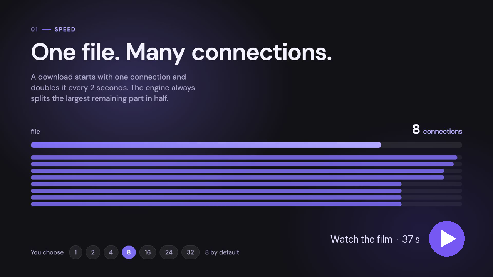
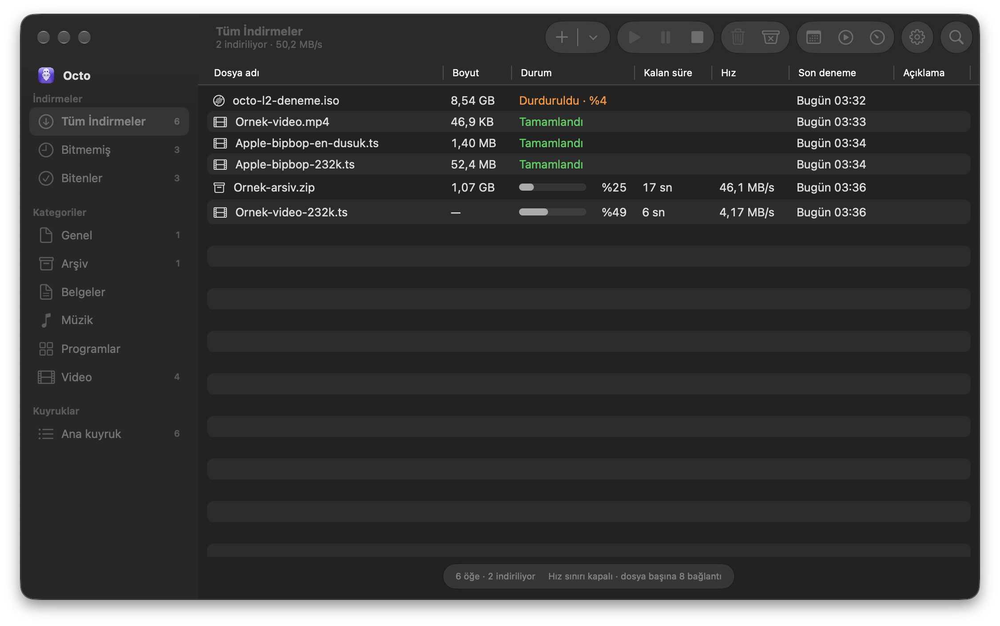
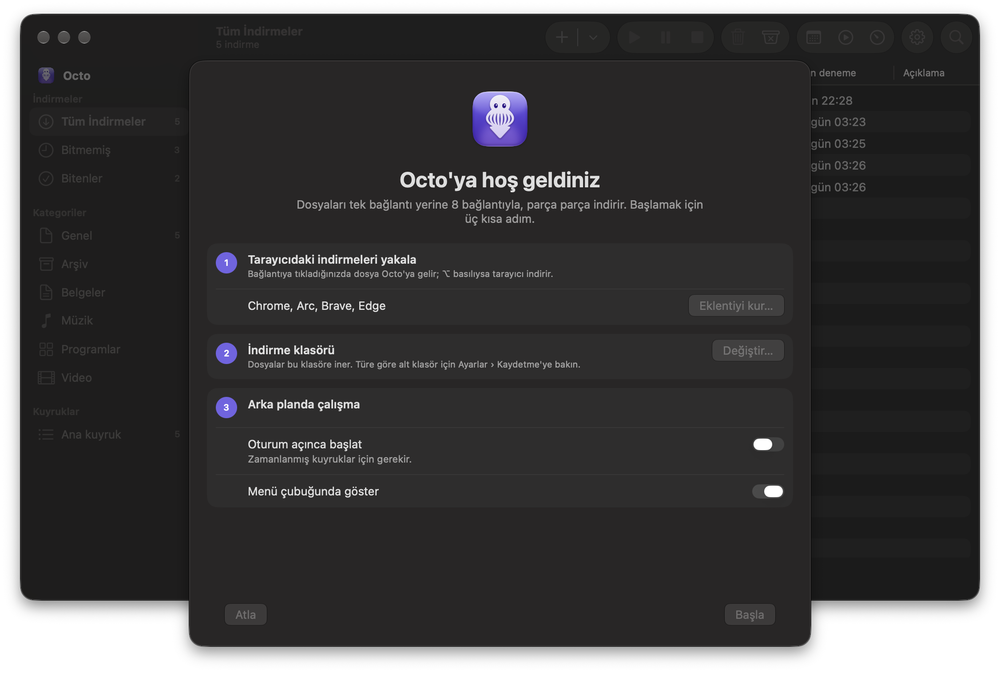

<p align="center">
  
</p>

<p align="center">
  <a href="https://github.com/ishflow/octo/releases/latest"></a>
  
  
  
  
  <a href="LICENSE"></a>
</p>

<p align="center">
  <a href="https://github.com/ishflow/octo/releases/latest"><b>İndir</b></a> ·
  <a href="https://ishflow.com/tr/ai/projects/octo">Web sitesi</a> ·
  <a href="#kurulum">Kurulum</a> ·
  <a href="#sss">SSS</a> ·
  <a href="README.md">English</a>
</p>

macOS için native indirme yöneticisi. Octo dosyayı parçalara böler ve birkaç bağlantıdan aynı anda indirir, yarım kalan indirmeyi sürdürür ve Chrome'daki indirmeleri devralır. Go indirme motoru, SwiftUI uygulaması (Liquid Glass) ve Chrome eklentisinden oluşur. Uygulama arayüzü Türkçedir.

<p align="center">
  <a href="https://ishflow.com/tr/ai/projects/octo"></a>
</p>

## Özellikler

<table>
  <tr>
    <td width="50%" valign="top">
      
      <h3>Tek dosya. Çok bağlantı.</h3>
      Varsayılan 8 bağlantı (1, 2, 4, 8, 16, 24 ya da 32). İndirme tek bağlantıyla başlar, 2 saniyede bir bağlantıyı ikiye katlar; motor her seferinde kalan en büyük parçayı ikiye böler.
    </td>
    <td width="50%" valign="top">
      
      <h3>Duraklat. Kapat. Sürdür.</h3>
      Kesilen indirme ve yeniden başlayan motor kaldığı yerden sürer (sunucu <code>Range</code> destekliyorsa). Süresi dolan link <b>Bağlantıyı yenile…</b> ile yenilenir; boyut aynıysa indirme devam eder.
    </td>
  </tr>
  <tr>
    <td width="50%" valign="top">
      
      <h3>Tarayıcıda tek tık.</h3>
      Bir <code>.zip</code> ya da <code>.iso</code> linkine tıklayınca indirme Octo'da başlar. Tarayıcının indirmesi için <b>Option</b>'a basılı tutun ya da sayfadaki tüm linkleri seçin. Chrome, Edge, Brave, Arc, Vivaldi.
    </td>
    <td width="50%" valign="top">
      
      <h3>Videonun üstünde indirme düğmesi.</h3>
      Düz video dosyaları, HLS (<code>.m3u8</code>) ve DASH (<code>.mpd</code>) akışları, kalite seçimiyle. Korumalı (DRM) videolar ve canlı yayınlar indirilmez.
    </td>
  </tr>
  <tr>
    <td width="50%" valign="top">
      
      <h3>Hep bir bakış uzağınızda.</h3>
      Menü çubuğunda aktif indirmeler, toplam hız ve tümünü durdur düğmesi. Pencereyi kapatsanız da indirmeler sürer.
    </td>
    <td width="50%" valign="top">
      <h3>Dahası</h3>
      <ul>
        <li><b>Kuyruk ve zamanlayıcı:</b> başlama ve durma saatleri, toplu indirme, toplam hız sınırı.</li>
        <li><b>Site girişleri</b> Keychain'de durur, yalnız <code>https://</code> adreslere gönderilir.</li>
        <li><b>Komut satırı:</b> <code>octo URL</code> doğrudan indirir, <code>octo add URL</code> uygulamaya ekler.</li>
        <li><b>Gizlilik:</b> telemetri yok, güncelleme denetimi yok.</li>
      </ul>
    </td>
  </tr>
</table>

## Ekran görüntüleri

<p align="center">
  
</p>
<p align="center">
  
</p>

## Gereksinimler

- macOS 26 veya üstü (Liquid Glass tasarım dili)
- Eklenti için Chrome ya da Chromium tabanlı bir tarayıcı

## Kurulum

1. Releases sayfasından `Octo-<sürüm>-macos.zip` dosyasını indirip açın. **Octo.app**'i `/Applications` içine taşıyın.
2. **İlk açılış (Gatekeeper).** Octo ad-hoc imzalıdır ve Apple tarafından onaylanmamıştır (notarize değil); macOS ilk açılışı engeller. **Octo.app**'e sağ tıklayıp **Aç**'ı seçin ve onaylayın. macOS 26'da "Aç" düğmesi çıkmıyorsa **Sistem Ayarları › Gizlilik ve Güvenlik** sayfasını açın, aşağıda Octo mesajının yanındaki **Yine de Aç**'a basın. Ya da Terminal'de karantina işaretini kaldırın:

   ```sh
   xattr -dr com.apple.quarantine /Applications/Octo.app
   ```
3. **Chrome eklentisi.** Uygulamanın karşılama ekranı (ve **Ayarlar › Tarayıcı › Eklentiyi kur…**) tarayıcılarınız için native-messaging host'unu yazar. Sonra eklentiyi yükleyin:
   1. `chrome://extensions` adresini açın, sağ üstten **Geliştirici modu**nu açın.
   2. **Paketlenmemiş öğe yükle** deyin ve uygulamanın içindeki `ChromeExtension` klasörünü seçin: `/Applications/Octo.app/Contents/Resources/ChromeExtension`. (Release aynı eklentiyi `Octo-Chrome-Extension-<sürüm>.zip` olarak da verir; zip'i açıp klasörü seçin.)
   3. Eklenti kimliği `elhjlbdkhcpjihiapkeoeceopennmkab` olmalı (manifest'teki `key` ile sabittir).
4. İsteğe bağlı komut satırı: `ln -s /Applications/Octo.app/Contents/MacOS/octo /opt/homebrew/bin/octo` (ya da `/usr/local/bin`).

İndirdiğiniz dosyaları doğrulamak için release dosyalarının klasöründe `shasum -a 256 -c SHA256SUMS` çalıştırın.

### Kaynaktan derleme

Go 1.26, Xcode ve XcodeGen gerekir.

```sh
scripts/build-app.sh          # build/Octo.app (universal, ad-hoc imzalı)
scripts/install.sh            # /Applications'a kopyalar, octo CLI bağını ve native-messaging manifestini yazar
scripts/package-release.sh    # dist/: uygulama zip'i, eklenti zip'i, SHA256SUMS
```

## Kaldırma

Kaynak klasöründen: `scripts/install.sh --uninstall`. Önce onay ister; `Octo.app`'i Çöp'e taşır, kendi kurduğu `octo` bağını ve `com.uba.octo` native-messaging manifestlerini kaldırır.

Elle: `Octo.app`'i Çöp'e taşıyın, eklentiyi `chrome://extensions` içinden kaldırın, `~/Library/Application Support/<tarayıcı>/NativeMessagingHosts/` altındaki `com.uba.octo.json` dosyalarını silin (Chrome için `Google/Chrome`). Octo'nun verisi siz silene kadar `~/Library/Application Support/Octo/` içinde kalır; yarım indirmeler indirme klasöründe `.part` + `.part.json` dosyalarıdır.

## SSS

**YouTube, Netflix ve benzerlerini indirir mi?**
Hayır. Octo yalnız tarayıcının açıkça gösterdiği video adreslerini (video dosyası, HLS, DASH) kullanır. DRM korumalı videolar hiçbir koşulda indirilmez; YouTube gibi kendi akış biçimini kullanan siteler desteklenmez.

**İndirme neden yavaş?**
Ayarlar › Bağlantı'dan bağlantı sayısını artırın. Bazı sunucular bağlantı sayısını sınırlar; motor bu durumda bağlantısını bir azaltır. `Range` desteklemeyen sunucularda dosya bölünemez ve devam edilemez (listede "Devam: Hayır" yazar).

**Link 403 veriyor ya da süresi dolmuş.**
İndirmeye sağ tıklayın, **Bağlantıyı yenile…** deyin ve yeni adresi girin. Boyut aynıysa indirme kaldığı yerden sürer.

**Eklentide "!" rozeti var.**
Native-messaging host manifesti yok ya da yol eski. **Ayarlar › Tarayıcı › Eklentiyi kur…** ile yeniden kurun, `chrome://extensions` içinde eklentiyi yenileyin. Uygulamayı taşıdıysanız da bunu yapın.

**Safari ya da Firefox?**
Onlar için eklenti yok. Adresi **URL ekle** ile Octo'ya yapıştırın.

**Bir yere veri gönderir mi?**
Octo'da telemetri ve güncelleme denetimi yoktur; yalnız indirdiğiniz dosyaların sunucularına bağlanır. Site parolaları Keychain'de kalır.

**Dosyalarım nerede?**
Belirlediğiniz indirme klasöründe (varsayılan `~/Downloads`); türe göre alt klasör isteğe bağlıdır (Ayarlar › Kaydetme).

**Başka bir uygulamanın kopyası mı?**
Hayır, sıfırdan yazıldı. Octo, indirme yöneticilerinden bilinen parçalı indirme yaklaşımını izler; başka bir indirme yöneticisinden kod içermez.

## Bilinen sınırlar

Bilerek verilmiş ya da henüz çözülmemiş sınırlar (POST indirmeleri, zamanlayıcı, video, eski "Hızlı İndir" ile yan yana çalışma…): [docs/BILINEN-SINIRLAR.md](docs/BILINEN-SINIRLAR.md).

## Geliştirici

```sh
go test -race ./...                       # motor testleri
go test -tags e2e -race ./...             # uçtan uca: soket servisi + gerçek ikili
(cd mac && xcodegen generate && xcodebuild test -scheme Octo -destination 'platform=macOS')
node --test extension/chrome/test/*.test.mjs
scripts/test-install.sh                   # install.sh'ı geçici HOME ile sınar
scripts/test-install-native-host.sh
scripts/test-release.sh                   # yayın betikleri
```

Mimari: tek Go ikilisi `octo` üç rol oynar: CLI, `serve` (motor servisi) ve `native-host` (Chrome'un başlattığı köprü). Uygulama motorun Unix soketi üzerinden (satır başına bir JSON) ince istemcisidir; tüm indirme durumu motorda tutulur.

```
Chrome eklentisi --native messaging--> octo native-host --+
                                                          +--> unix socket --> octo serve
Octo.app (SwiftUI) -------------------------------------- +     (Go motoru: kuyruk, devam,
                                                                  zamanlayıcı, hız sınırı)
```

## Lisans

[MIT](LICENSE)
