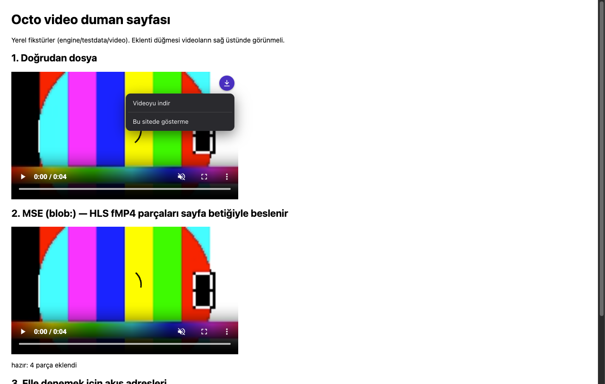
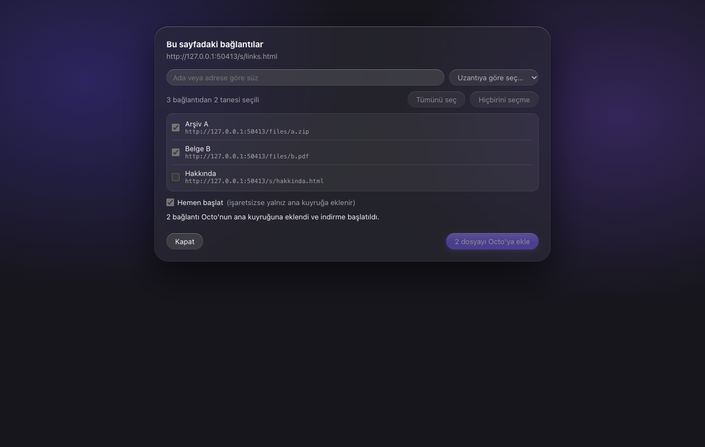

# Octo

[English](README.md)

macOS için native indirme yöneticisi. Octo dosyayı parçalara böler ve birkaç bağlantıdan aynı anda indirir, yarım kalan indirmeyi sürdürür ve Chrome'daki indirmeleri devralır. Go indirme motoru, SwiftUI uygulaması (Liquid Glass) ve Chrome eklentisinden oluşur. Uygulama arayüzü Türkçedir.


## Özellikler

- **Çok bağlantı.** Varsayılan 8 bağlantı (1, 2, 4, 8, 16, 24 ya da 32). İndirme tek bağlantıyla başlar, en erken 2 saniyede bir bağlantıyı ikiye katlar; motor her seferinde kalan en büyük parçayı ikiye böler.
- **Devam.** Duraklatıp sürdürebilirsiniz; kesilen indirme ve yeniden başlayan motor kaldığı yerden sürer (sunucu `Range` destekliyorsa). Süresi dolan link **Bağlantıyı yenile…** ile (sağ tık menüsü) yenilenir; dosya boyutu aynıysa indirme kaldığı yerden sürer.
- **Kuyruk ve zamanlayıcı.** Başlama ve durma saatli birden çok kuyruk, toplu indirme (**Toplu indirme…**) ve toplam hız sınırı. Zamanlayıcının ayrıntıları ve sınırları: [bilinen sınırlar](docs/BILINEN-SINIRLAR.md).
- **Menü çubuğu simgesi.** Aktif indirmeler, toplam hız ve tümünü durdur düğmesi; pencereyi kapatsanız da indirmeler sürer.
- **Chrome eklentisi.** Bir `.zip` ya da `.iso` linkine tıklayınca indirme tarayıcıda değil Octo'da başlar. Tarayıcının indirmesi için **Option** tuşuna basılı tutun. Sağ tık menüsünde "Octo ile indir" ve "Tüm linkleri Octo ile indir" vardır. Chrome ve Chromium tabanlı tarayıcılarla çalışır (Edge, Brave, Arc, Vivaldi…).
- **Video yakalayıcı.** Sayfadaki videoların üstünde küçük bir indirme düğmesi çıkar. Düz video dosyalarını, HLS (`.m3u8`) ve DASH (`.mpd`) akışlarını indirir; kaliteyi seçebilirsiniz.
  **DRM yok:** korumalı videolar (Widevine/FairPlay, şifreli HLS) indirilmez ve Octo korumayı aşmaya çalışmaz. Canlı yayınlar desteklenmez.

  
- **Site girişleri.** Site başına kullanıcı adı ve parola kaydedebilirsiniz (Keychain'de durur, yalnız `https://` adreslere gönderilir).
- **Komut satırı.** `octo URL` doğrudan indirir, `octo add URL` çalışan uygulamaya ekler.




## Gereksinimler

- macOS 26 veya üstü (Liquid Glass tasarım dili)
- Eklenti için Chrome ya da Chromium tabanlı bir tarayıcı

## Kurulum

1. Releases sayfasından `Octo-<sürüm>-macos.zip` dosyasını indirip açın. **Octo.app**'i `/Applications` içine taşıyın.
2. **İlk açılış (Gatekeeper).** Octo ad-hoc imzalıdır ve Apple tarafından onaylanmamıştır (notarize değil); macOS ilk açılışı engeller. **Octo.app**'e sağ tıklayıp **Aç**'ı seçin ve onaylayın. macOS 26'da "Aç" düğmesi çıkmıyorsa **Sistem Ayarları › Gizlilik ve Güvenlik** sayfasını açın, aşağıda Octo mesajının yanındaki **Yine de Aç**'a basın. Ya da Terminal'de karantina işaretini kaldırın:

   ```sh
   xattr -dr com.apple.quarantine /Applications/Octo.app
   ```
3. **Chrome eklentisi.** Uygulamanın karşılama ekranı (ve **Ayarlar › Tarayıcı › Eklentiyi kur…**) tarayıcılarınız için native-messaging host'unu yazar. Sonra eklentiyi yükleyin:
   1. `chrome://extensions` adresini açın, sağ üstten **Geliştirici modu**nu açın.
   2. **Paketlenmemiş öğe yükle** deyin ve uygulamanın içindeki `ChromeExtension` klasörünü seçin: `/Applications/Octo.app/Contents/Resources/ChromeExtension`. (Release aynı eklentiyi `Octo-Chrome-Extension-<sürüm>.zip` olarak da verir; zip'i açıp klasörü seçin.)
   3. Eklenti kimliği `elhjlbdkhcpjihiapkeoeceopennmkab` olmalı (manifest'teki `key` ile sabittir).
4. İsteğe bağlı komut satırı: `ln -s /Applications/Octo.app/Contents/MacOS/octo /opt/homebrew/bin/octo` (ya da `/usr/local/bin`).

İndirdiğiniz dosyaları doğrulamak için release dosyalarının klasöründe `shasum -a 256 -c SHA256SUMS` çalıştırın.

### Kaynaktan derleme

Go 1.26, Xcode ve XcodeGen gerekir.

```sh
scripts/build-app.sh          # build/Octo.app (universal, ad-hoc imzalı)
scripts/install.sh            # /Applications'a kopyalar, octo CLI bağını ve native-messaging manifestini yazar
scripts/package-release.sh    # dist/: uygulama zip'i, eklenti zip'i, SHA256SUMS
```

## Kaldırma

Kaynak klasöründen: `scripts/install.sh --uninstall`. Önce onay ister; `Octo.app`'i Çöp'e taşır, kendi kurduğu `octo` bağını ve `com.uba.octo` native-messaging manifestlerini kaldırır.

Elle: `Octo.app`'i Çöp'e taşıyın, eklentiyi `chrome://extensions` içinden kaldırın, `~/Library/Application Support/<tarayıcı>/NativeMessagingHosts/` altındaki `com.uba.octo.json` dosyalarını silin (Chrome için `Google/Chrome`). Octo'nun verisi siz silene kadar `~/Library/Application Support/Octo/` içinde kalır; yarım indirmeler indirme klasöründe `.part` + `.part.json` dosyalarıdır.

## SSS

**YouTube, Netflix ve benzerlerini indirir mi?**
Hayır. Octo yalnız tarayıcının açıkça gösterdiği video adreslerini (video dosyası, HLS, DASH) kullanır. DRM korumalı videolar hiçbir koşulda indirilmez; YouTube gibi kendi akış biçimini kullanan siteler desteklenmez.

**İndirme neden yavaş?**
Ayarlar › Bağlantı'dan bağlantı sayısını artırın. Bazı sunucular bağlantı sayısını sınırlar; motor bu durumda bağlantısını bir azaltır. `Range` desteklemeyen sunucularda dosya bölünemez ve devam edilemez (listede "Devam: Hayır" yazar).

**Link 403 veriyor ya da süresi dolmuş.**
İndirmeye sağ tıklayın, **Bağlantıyı yenile…** deyin ve yeni adresi girin. Boyut aynıysa indirme kaldığı yerden sürer.

**Eklentide "!" rozeti var.**
Native-messaging host manifesti yok ya da yol eski. **Ayarlar › Tarayıcı › Eklentiyi kur…** ile yeniden kurun, `chrome://extensions` içinde eklentiyi yenileyin. Uygulamayı taşıdıysanız da bunu yapın.

**Safari ya da Firefox?**
Onlar için eklenti yok. Adresi **URL ekle** ile Octo'ya yapıştırın.

**Bir yere veri gönderir mi?**
Octo'da telemetri ve güncelleme denetimi yoktur; yalnız indirdiğiniz dosyaların sunucularına bağlanır. Site parolaları Keychain'de kalır.

**Dosyalarım nerede?**
Belirlediğiniz indirme klasöründe (varsayılan `~/Downloads`); türe göre alt klasör isteğe bağlıdır (Ayarlar › Kaydetme).

**Başka bir uygulamanın kopyası mı?**
Hayır, sıfırdan yazıldı. Octo, indirme yöneticilerinden bilinen parçalı indirme yaklaşımını izler; başka bir indirme yöneticisinden kod içermez.

## Bilinen sınırlar

Bilerek verilmiş ya da henüz çözülmemiş sınırlar (POST indirmeleri, zamanlayıcı, video, eski "Hızlı İndir" ile yan yana çalışma…): [docs/BILINEN-SINIRLAR.md](docs/BILINEN-SINIRLAR.md).

## Geliştirici

```sh
go test -race ./...                       # motor testleri
go test -tags e2e -race ./...             # uçtan uca: soket servisi + gerçek ikili
(cd mac && xcodegen generate && xcodebuild test -scheme Octo -destination 'platform=macOS')
node --test extension/chrome/test/*.test.mjs
scripts/test-install.sh                   # install.sh'ı geçici HOME ile sınar
scripts/test-install-native-host.sh
scripts/test-release.sh                   # yayın betikleri
```

Mimari: tek Go ikilisi `octo` üç rol oynar: CLI, `serve` (motor servisi) ve `native-host` (Chrome'un başlattığı köprü). Uygulama motorun Unix soketi üzerinden (satır başına bir JSON) ince istemcisidir; tüm indirme durumu motorda tutulur.

```
Chrome eklentisi --native messaging--> octo native-host --+
                                                          +--> unix socket --> octo serve
Octo.app (SwiftUI) -------------------------------------- +     (Go motoru: kuyruk, devam,
                                                                  zamanlayıcı, hız sınırı)
```

## Lisans

[MIT](LICENSE)
